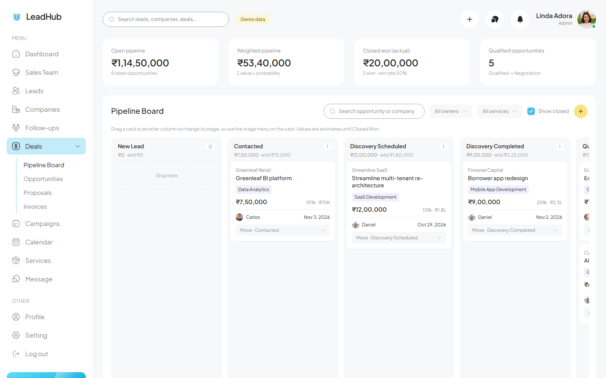
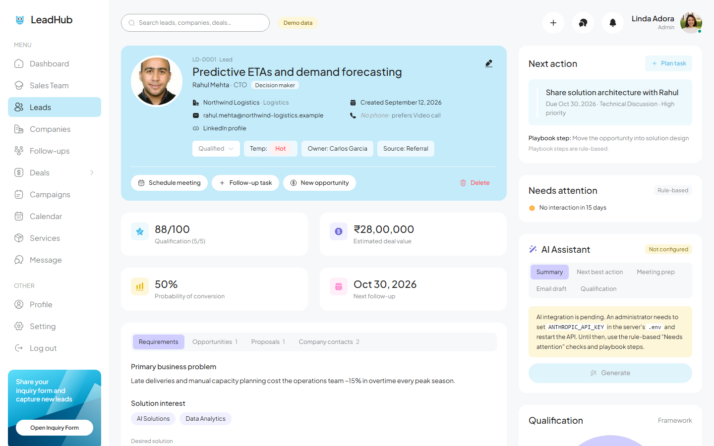
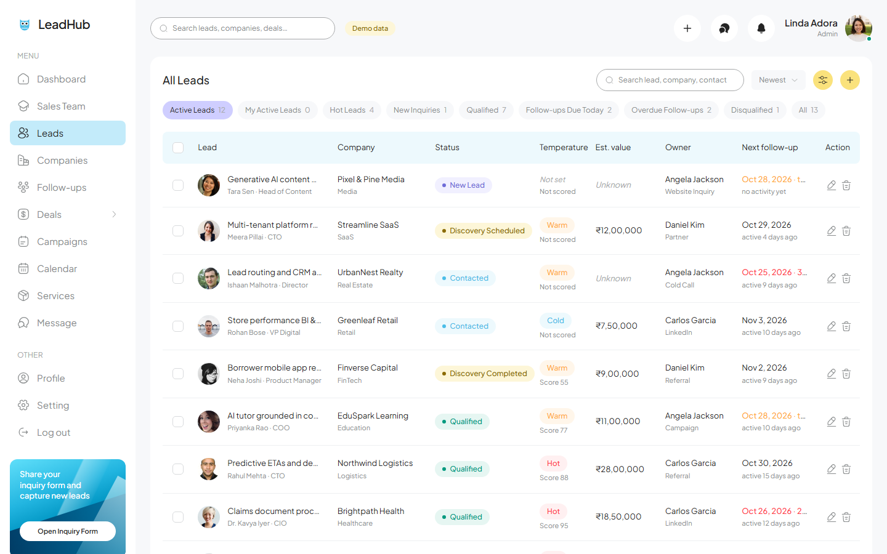
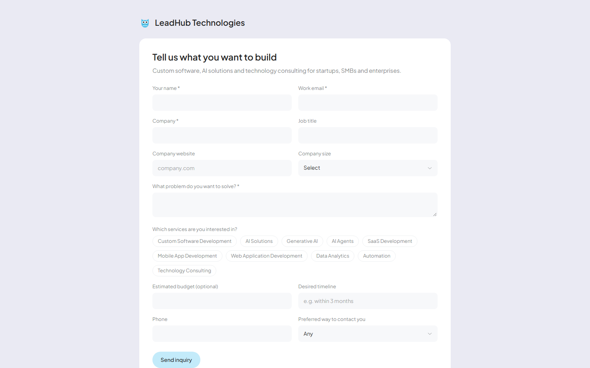
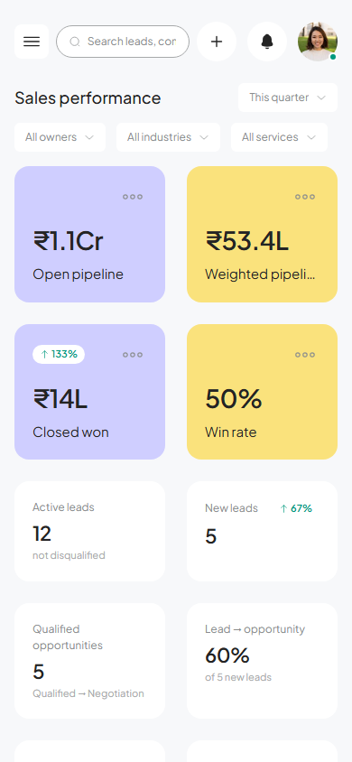
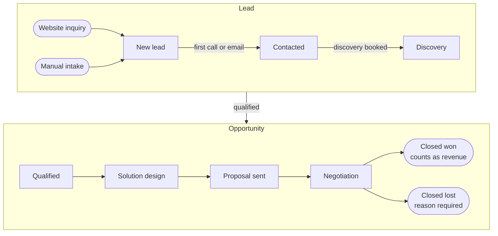
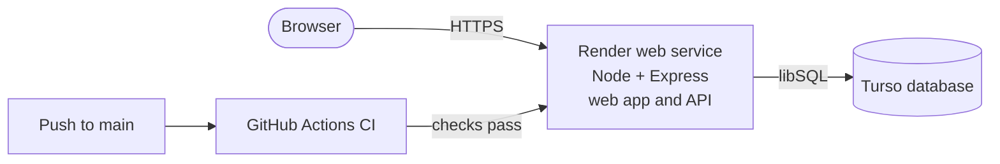
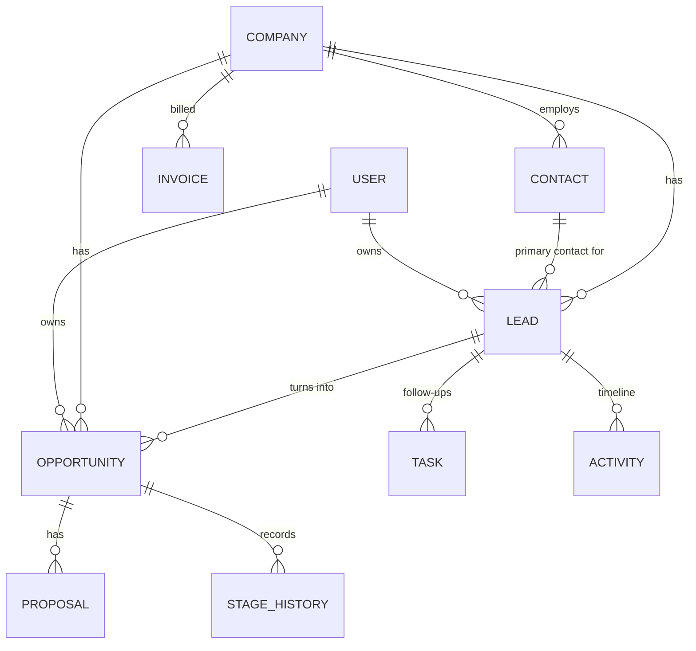

<div align="center">


# LeadHub

**A sales CRM for teams that sell custom software, AI solutions and technology consulting.**<br>
Capture leads, qualify them, run the pipeline, send proposals and close deals, all in one place.

[](https://leadhub-9stj.onrender.com)
[](https://github.com/rrushikeshp89/leadhub-crm/actions/workflows/ci.yml)
[](#quality-and-security)
[](#quality-and-security)
[](https://github.com/rrushikeshp89/leadhub-crm/commits/main)
[](LICENSE)

[**Open the live app**](https://leadhub-9stj.onrender.com) ·
[**Try the public inquiry form**](https://leadhub-9stj.onrender.com/inquiry) ·
[Run it locally](#quick-start) ·
[Deploy it for free](docs/deploy-render.md)

</div>


> [!NOTE]
> **About the live demo.** The CRM at [leadhub-9stj.onrender.com](https://leadhub-9stj.onrender.com) holds a real team's data, so signing in is by invitation only. Anyone can try the **[public inquiry form](https://leadhub-9stj.onrender.com/inquiry)**: each submission becomes a new lead with a follow-up task inside the CRM. The app runs on a free plan and sleeps after 15 quiet minutes, so the first visit can take about a minute to load. For a full tour with demo data, [run it locally](#quick-start) in two minutes.

## Contents

- [Highlights](#highlights)
- [Screenshots](#screenshots)
- [How a deal moves](#how-a-deal-moves)
- [Built with](#built-with)
- [Skills demonstrated](#skills-demonstrated)
- [Quick start](#quick-start)
- [Deployment](#deployment)
- [Architecture](#architecture)
- [Quality and security](#quality-and-security)
- [AI assistant](#ai-assistant)
- [What's real, what's next](#whats-real-whats-next)
- [Credits and license](#credits-and-license)

## Highlights

| | |
| --- | --- |
| **Lead intake without duplicates** | One form creates the company, contact and lead together, and warns before creating a second copy of an existing company (by name or website) or person (by email). |
| **A 10-stage pipeline board** | Drag deals from New Lead to Closed Won or Lost. Every move is recorded, probability follows the stage, and a lost deal always needs a reason. |
| **Numbers you can trust** | Weighted pipeline = deal value × probability. Only Closed Won counts as revenue, and estimates are always labelled as estimates. |
| **Nothing slips** | Tasks with due dates, overdue tracking, a contact log and an activity timeline on every lead, deal and company. |
| **Qualification scoring** | Rate business need, service fit, budget readiness, timeline and decision-maker access; the score suggests Hot, Warm or Cold. Admins can change the criteria and weights. |
| **A public inquiry form** | Website visitors describe their project; LeadHub turns it into a lead, assigns the least-busy rep and creates a response task. |
| **Roles** | Admins see and configure everything; sales reps get their own day view and can't change org settings. |
| **Optional AI assistant** | Lead summaries, next best action, meeting briefs and email drafts with Claude. Suggestions only, never silent changes. |
| **Works on any screen** | A responsive layout from a 390 px phone to a wide desktop. |

## Screenshots

<table>
  <tr>
    <td width="50%" valign="top">
      
      <p align="center"><b>Pipeline board</b>: drag a deal to change its stage.</p>
    </td>
    <td width="50%" valign="top">
      
      <p align="center"><b>Lead detail</b>: everything about a deal on one page.</p>
    </td>
  </tr>
  <tr>
    <td width="50%" valign="top">
      
      <p align="center"><b>Leads</b>: saved views, filters and search.</p>
    </td>
    <td width="50%" valign="top">
      
      <p align="center"><b>Public inquiry form</b>: new leads straight from your website.</p>
    </td>
  </tr>
</table>

<details>
<summary><b>Mobile view</b> (390 px wide)</summary>
<br>
<p align="center">
  
</p>
</details>

<sub>Every company, person and figure in the screenshots is fictional demo data.</sub>

## How a deal moves



Status changes like "Contacted" and "Discovery Scheduled" happen automatically when you log the matching activity, and every change is written to the record's timeline.

## Built with

**Frontend**


**Backend and data**


-4FF8D2?style=for-the-badge&logo=turso&logoColor=black)


**DevOps and quality**


**AI and design**


## Skills demonstrated

| Skill | Where to look |
| --- | --- |
| **Full-stack TypeScript** with one domain model shared by browser and server | [`shared/`](shared) |
| **REST API design** with validation, roles and consistent errors | [`server/routes.ts`](server/routes.ts), [`shared/schemas.ts`](shared/schemas.ts) |
| **Business logic and data integrity**: activity logging, stage history, duplicate detection, foreign-key rules | [`server/service.ts`](server/service.ts), [`server/db.ts`](server/db.ts) |
| **Async data layer**: re-entrant transactions with savepoints, a write queue, race-free record codes | [`server/db.ts`](server/db.ts), [`server/repo.ts`](server/repo.ts) |
| **Authentication and security**: scrypt hashing, httpOnly session cookies, rate limiting, CSP and HSTS | [`server/auth.ts`](server/auth.ts), [`server/security.ts`](server/security.ts) |
| **React UI engineering**: a design system from a Figma template, optimistic updates with rollback, per-page code splitting | [`src/components/`](src/components), [`src/store/Store.tsx`](src/store/Store.tsx) |
| **Data visualisation** with Recharts | [`src/pages/Dashboard.tsx`](src/pages/Dashboard.tsx) |
| **LLM integration** with structured output and graceful fallback | [`server/ai.ts`](server/ai.ts) |
| **Testing**: end-to-end API tests, concurrency and hardening tests | [`tests/`](tests) |
| **CI/CD and containers**: GitHub Actions, a non-root Docker image tested in CI, Dependabot, protected `main` | [`.github/`](.github), [`Dockerfile`](Dockerfile) |
| **Cloud deployment** as infrastructure-as-code on free hosting | [`render.yaml`](render.yaml), [`docs/deploy-render.md`](docs/deploy-render.md) |

## Quick start

You need **Node.js 24** (anything from 22.13 works; see [`.nvmrc`](.nvmrc)).

```bash
git clone https://github.com/rrushikeshp89/leadhub-crm.git
cd leadhub-crm
npm install
cp .env.example .env
npm run dev
```

Open **http://localhost:5173**. On first start LeadHub creates a local database (`data/crm.db`), an admin account, the service catalog and a set of fictional demo data.

- **Sign in** with `SEED_ADMIN_EMAIL` and `SEED_ADMIN_PASSWORD` from `.env`. If you leave the password empty, a random one is printed in the terminal on first run.
- **Public inquiry form:** http://localhost:5173/inquiry
- **Start clean:** set `SEED_DEMO=false` before the first run, or clear demo data later in **Settings → Demo data**.

<details>
<summary><b>All scripts</b></summary>

| Command | What it does |
| --- | --- |
| `npm run dev` | API on port 4000 and web app on port 5173, both with hot reload |
| `npm test` | End-to-end API, data-layer, hardening and validation tests |
| `npm run typecheck` | Type-checks client, server, shared code and tests |
| `npm run build` | Type-check, then build the client (`dist/`) and bundle the server (`dist-server/`) |
| `npm start` | Runs the built server, which serves the API and the web app from one process |
| `npm run verify` | Build plus tests, as run before every release |

</details>

<details>
<summary><b>Configuration</b> (environment variables)</summary>

All settings are environment variables, and [`.env.example`](.env.example) documents each one. Setting `NODE_ENV=production` switches on the safe defaults in the third column.

| Variable | Default | Production default | Purpose |
| --- | --- | --- | --- |
| `API_PORT` / `PORT` | `4000` | | Port to listen on (`API_PORT` wins when both are set) |
| `DATABASE_URL` | `data/crm.db` | | A local SQLite file path, or a Turso URL (`libsql://…`). `DB_PATH` is the older name |
| `DATABASE_AUTH_TOKEN` | none | | Turso access token |
| `COOKIE_SECURE` | `false` | `true` | HTTPS-only session cookies and HSTS |
| `TRUST_PROXY` | `loopback` | | Proxies whose `X-Forwarded-For` is trusted: a hop count, `true`/`false` or addresses |
| `LOG_REQUESTS` | `false` | `true` | One JSON log line per request (no query strings, bodies or cookies) |
| `BACKUP_INTERVAL_HOURS` | `0` (off) | `24` | Snapshot interval for a local database file (Turso has its own restore) |
| `BACKUP_DIR` / `BACKUP_KEEP` | `backups` next to the database / `7` | | Where snapshots go and how many are kept |
| `SEED_ADMIN_EMAIL` / `SEED_ADMIN_PASSWORD` | `admin@leadhub.local` / random | password **required** | First admin account (password at least 12 characters) |
| `SEED_DEMO` | `true` | `false` | Load fictional demo data on first run |
| `SEED_REP_PASSWORD` | random | | Password for the demo sales reps |
| `ANTHROPIC_API_KEY` | none | | Turns on the AI assistant |
| `ANTHROPIC_MODEL` | `claude-opus-5-5` | | Claude model used by the AI assistant |

</details>

## Deployment

| Option | Cost | Guide |
| --- | --- | --- |
| **Render + Turso** (what the live demo uses) | Free | [docs/deploy-render.md](docs/deploy-render.md): one Blueprint ([`render.yaml`](render.yaml)) and a hosted database |
| **Any Docker host with a persistent disk** | Varies | [`Dockerfile`](Dockerfile) with a local SQLite file at `/data`; see [docs/deploy-railway.md](docs/deploy-railway.md) |



In production the server refuses to start on an empty database without a strong admin password, loads no demo data unless asked, sends security headers, answers a `/api/health` probe that checks the database, and shuts down cleanly when the host stops it.

## Architecture

```text
shared/        Domain model, business calculations and validation, used by client AND server
  model.ts       stages, lead statuses, service categories, lost reasons, entity types, settings
  calc.ts        weighted pipeline, win rate, stage conversion, qualification score, overdue rules
  schemas.ts     zod schemas for every write (the server enforces them; the client shows field errors)
server/        Express 5 + libSQL
  db.ts          libSQL client, versioned migrations, queued re-entrant transactions
  repo.ts        row ↔ model mapping, readable codes (LD-0001, OP-0001, PR-0001…)
  service.ts     business rules, activity log, stage history, duplicate detection, intake, inquiries
  auth.ts        scrypt password hashing, httpOnly session cookies, role checks
  security.ts    Content Security Policy and other headers, request log
  routes.ts      REST API
  ai.ts          Claude integration (server-side only)
  seed.ts        service catalog and fictional demo data
src/           React app (design tokens in tailwind.config.js and src/lib/theme.ts)
  store/         loads /api/bootstrap after sign-in, applies changes, re-syncs side effects
  pages/         one file per screen, loaded on demand
  components/    layout, UI kit, CRM blocks (timeline, tasks, next action, AI assistant), forms
tests/         node:test end-to-end tests on an in-memory database
```

<details>
<summary><b>Data model</b></summary>



Foreign keys protect the data:

- A company can't be deleted while it has leads, opportunities or invoices; its contacts go with it.
- A contact who is a lead's primary contact can't be deleted.
- Deleting a lead removes its tasks and activity history; its opportunities stay with the company.
- Deleting an opportunity removes its proposals, tasks, history and activities.
- The server also rejects a lead or opportunity whose contact belongs to a different company.

Schema changes go in `server/db.ts → MIGRATIONS` (append only; each runs once, inside a transaction).

</details>

<details>
<summary><b>Business rules</b></summary>

All calculations live in one place, [`shared/calc.ts`](shared/calc.ts), so the dashboard and the server always agree.

- **Stages:** New Lead → Contacted → Discovery Scheduled → Discovery Completed → Qualified Opportunity → Solution Design → Proposal Sent → Negotiation → Closed Won or Closed Lost.
- **Probability** follows the stage default (configurable in Settings) unless entered by hand; Closed Won is 100 %, Closed Lost 0 %.
- **Weighted pipeline** = estimated value × probability, open deals only.
- **Revenue** counts Closed Won only.
- **Closed Lost** needs a reason (budget, competitor, postponed, requirements mismatch, no response, cancelled, other). Reopening clears it.
- **Win rate** = won ÷ (won + lost) for deals closed in the period. **Lead → opportunity conversion** = share of leads with at least one opportunity.
- **Qualification score** = weighted share of the maximum across the criteria; 70 and above suggests Hot, 40 and above Warm.
- **Overdue** = an open task due before today.
- **Automatic status updates:** the first call, email or meeting → *Contacted*; a booked discovery meeting → *Discovery Scheduled*; an opportunity reaching Qualified or beyond → lead *Qualified*. Leads only move forward and never leave *Disqualified* on their own.
- **Duplicates:** intake checks company name (ignoring Inc, Ltd, Pvt…), website domain and contact email; the public form reuses existing records and never opens a second lead for the same person.

</details>

## Quality and security

- **37 automated tests** run on every pull request:
  - the full lead-to-close lifecycle for a fictional client
  - permissions and data integrity
  - 12 simultaneous writes on one database file
  - nested transactions
  - security headers and rate limits behind a proxy
  - backups
  - the exact validation messages users see
- **CI** type-checks, tests and builds every change, then builds the Docker image and tests it as a real host would: non-root user, database ownership, clean shutdown on SIGTERM, data surviving a new container.
- **Protected `main`:** changes land only through pull requests with passing checks.
- **Dependencies:** Dependabot opens weekly update PRs; `npm audit` reports 0 vulnerabilities.
- **In the app:**
  - scrypt-hashed passwords and httpOnly, SameSite, HTTPS-only session cookies
  - JSON-only writes, which block cross-site form posts
  - rate-limited sign-in and inquiry forms
  - a strict Content Security Policy with HSTS, `X-Frame-Options: DENY` and no `X-Powered-By`
- **Secrets** never live in the repository: the host's dashboard holds them, and GitHub secret scanning with push protection is on.

Found a vulnerability? Please report it privately; see [SECURITY.md](SECURITY.md).

## AI assistant

Lead summary, qualification suggestions, next best action, meeting briefs and email drafts are built on the official Anthropic SDK ([`server/ai.ts`](server/ai.ts)), with structured JSON output.

- **Off until configured:** add `ANTHROPIC_API_KEY` and restart. Until then the UI says "Not configured", and no placeholder output is ever shown.
- **Private by design:** the key stays on the server, and a prompt contains only the record you're looking at.
- **Suggestions, not changes:** nothing is saved unless you click to apply it.
- **Rule-based checks** (missing information, overdue follow-ups, stalled deals, proposals awaiting a reply) work without AI and are labelled "Rule-based".

## What's real, what's next

| Works today | Not built yet (the UI says so) |
| --- | --- |
| Persistent data, sessions, admin and sales-rep roles | Sending email, calendar invites or push notifications (reminders are in-app) |
| Companies, contacts, leads, opportunities, tasks, activities, proposals, events, invoices, services, campaigns, team chat | Generating proposal documents and tracking when they're viewed |
| Pipeline drag and drop with optimistic update and rollback | CSV import and export |
| Live dashboard metrics with date, owner, industry and service filters | Multiple organisations in one installation |
| Public inquiry form with spam honeypot and rate limit | |

## Credits and license

The interface is adapted from the **SchoolHub – School Management Admin Dashboard** community template on Figma, redesigned for sales and lead management.

© 2026 Rushikesh Panchal. The source is published for viewing only; all rights reserved. See [LICENSE](LICENSE).
