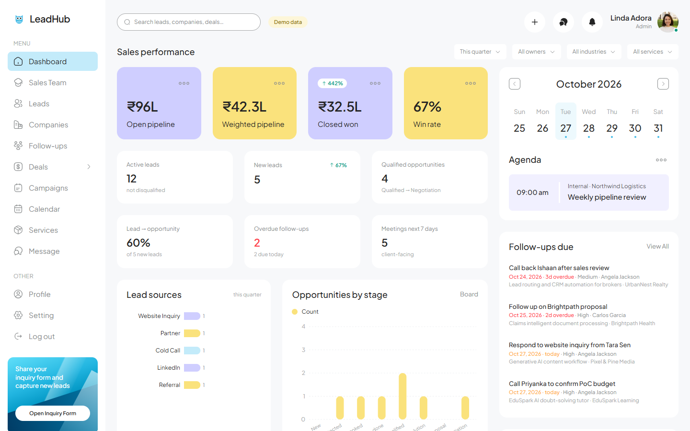

# LeadHub

[](https://github.com/rrushikeshp89/leadhub-crm/actions/workflows/ci.yml)

A B2B sales CRM for a company that sells **custom software development, AI solutions and technology consulting**. It covers capturing leads, qualifying prospects, managing the opportunity pipeline, tracking proposals, closing deals and following up.



> All companies, people and figures in the demo dataset are fictional. The app shows a **“Demo data”** badge until an admin clears them in **Settings → Demo data**.

## Features

- **Leads:** intake with duplicate detection (company name, website domain, contact email), qualification scoring, temperature, owner assignment and saved views.
- **Pipeline:** a 10-stage Kanban with drag and drop, required lost reasons and recorded stage history.
- **Opportunities:** weighted value (value × stage probability), expected close dates and next actions.
- **Proposals, tasks and follow-ups:** overdue tracking, a contact log and an activity timeline on every record.
- **Companies and contacts**, plus invoices, a service catalog, campaigns, a calendar and team chat.
- **Dashboard:** live metrics with date, owner, industry and service filters. Only Closed Won counts as revenue.
- **Public inquiry form** (`/inquiry`, no sign-in): each submission becomes a New Lead with a response task.
- **Roles:** admins and sales reps.
- **Optional AI assistant** powered by Claude. It runs server-side only and is off until a key is configured.

## Tech stack

| Layer | Choice |
| --- | --- |
| Frontend | React 18, Vite 5, TypeScript, Tailwind CSS 3, Recharts |
| Backend | Express 5 on Node.js, libSQL (SQLite-compatible): a local file in development, Turso in production |
| Shared | Domain model, business calculations and zod validation used by both client and server |
| Tests | `node:test` end-to-end API tests on an in-memory database |

## Quick start

Requirements: **Node.js 24 LTS** (any version ≥ 22.13 works; see `.nvmrc`).

```bash
npm install
cp .env.example .env
npm run dev
```

`npm run dev` starts the API on port 4000 and the web app on port 5173 (Vite proxies `/api`). Then open http://localhost:5173.

On first start the server creates the database (`data/crm.db`), an admin account, the service catalog and, unless `SEED_DEMO=false`, the demo dataset.

- **Sign-in:** use `SEED_ADMIN_EMAIL` / `SEED_ADMIN_PASSWORD` from `.env`. If the password is empty, a random one is printed in the server log on first run. These values are read only while the database has no users.
- **Public inquiry form:** http://localhost:5173/inquiry

## Configuration

All settings are environment variables; `.env.example` documents each one. Setting `NODE_ENV=production` switches on the safe defaults in the third column.

| Variable | Default | Production default | Purpose |
| --- | --- | --- | --- |
| `API_PORT` / `PORT` | `4000` | | Port to listen on (`API_PORT` wins when both are set) |
| `DATABASE_URL` | `data/crm.db` | | A local SQLite file path, or a Turso URL (`libsql://…`). `DB_PATH` is the older name |
| `DATABASE_AUTH_TOKEN` | none | | Turso access token |
| `COOKIE_SECURE` | `false` | `true` | HTTPS-only session cookies and HSTS |
| `TRUST_PROXY` | `loopback` | | Proxies whose `X-Forwarded-For` is trusted: a hop count (`1` for most hosts), `true`/`false` or addresses |
| `LOG_REQUESTS` | `false` | `true` | One JSON log line per request (no query strings, bodies or cookies) |
| `BACKUP_INTERVAL_HOURS` | `0` (off) | `24` | Snapshot interval for a local database file (Turso has its own restore) |
| `BACKUP_DIR` / `BACKUP_KEEP` | `backups` next to the database / `7` | | Where snapshots go and how many are kept |
| `SEED_ADMIN_EMAIL` / `SEED_ADMIN_PASSWORD` | `admin@leadhub.local` / random | password **required** | First admin account (password at least 12 characters) |
| `SEED_DEMO` | `true` | `false` | Load fictional demo data on first run |
| `SEED_REP_PASSWORD` | random | | Password for the demo sales reps |
| `ANTHROPIC_API_KEY` | none | | Turns on the AI features |
| `ANTHROPIC_MODEL` | `claude-opus-5-5` | | Claude model used by the AI features |

## Scripts

| Command | What it does |
| --- | --- |
| `npm run dev` | API + web app with hot reload |
| `npm test` | End-to-end API tests: Acme Technologies scenario, data integrity, permissions, inquiry dedupe, AI fallback, demo seed |
| `npm run typecheck` | Type-checks client, server and shared code |
| `npm run build` | Type-check, then build the client (`dist/`) and bundle the server (`dist-server/`) |
| `npm start` | Runs the built server, which serves the API and the client from one process (set `NODE_ENV=production` in production) |
| `npm run verify` | Build + tests, as run before every release |

## Running in production

```bash
npm ci
npm run build
npm ci --omit=dev     # optional: drop build tools from the runtime
NODE_ENV=production npm start
```

**Deploying:** [docs/deploy-render.md](docs/deploy-render.md) sets up the free hosting: a Render web service from [`render.yaml`](render.yaml) with a Turso database. On a host with a persistent disk, the same `Dockerfile` can keep a local database file at `/data` instead (see [docs/deploy-railway.md](docs/deploy-railway.md)).

The server is a single Node process that serves both `/api` and the web app. Data lives either in a hosted Turso database (`DATABASE_URL=libsql://…`), which suits hosts without a persistent disk, or in a local SQLite file on a persistent disk.

In production the server:
- refuses to start on an empty database unless `SEED_ADMIN_PASSWORD` (12+ characters) is set, and loads no demo data unless asked;
- sends a Content Security Policy, HSTS (over HTTPS) and anti-framing headers, and caches fingerprinted assets for a year;
- answers `GET /api/health` (checks the database) for the host's health probe;
- for a local database file, writes a snapshot every 24 hours with `VACUUM INTO` and keeps the newest 7;
- on `SIGTERM`, finishes open requests, checkpoints the WAL and closes the database before exiting.

## Architecture

```
shared/        Domain model, business calculations, validation (used by client AND server)
  model.ts       stages, lead statuses, service categories, lost reasons, entity types, settings
  calc.ts        weighted pipeline, win rate, stage conversion, qualification score, overdue rules, money format
  schemas.ts     zod schemas for every write (server enforces; client shows field errors)
server/        Express 5 + libSQL
  db.ts          libSQL client, versioned migrations, queued re-entrant transactions
  repo.ts        row ↔ model mapping, readable codes (LD-0001, OP-0001, PR-0001…)
  service.ts     business rules, activity logging, stage history, duplicate detection, intake, inquiry
  auth.ts        scrypt password hashing, httpOnly session cookies, role checks
  routes.ts      REST API
  ai.ts          Claude integration (server-side only)
  seed.ts        service catalog + fictional demo data
src/           React app (design tokens in tailwind.config.js and src/lib/theme.ts)
  store/         loads /api/bootstrap after sign-in, applies mutations, re-syncs side effects
  pages/         one file per screen
  components/    layout, UI kit, CRM blocks (timeline, tasks, next action, AI assistant, stage stepper), forms
tests/         node:test end-to-end API tests
```

### Data model

`companies` 1—n `contacts` · `companies` 1—n `leads` (each lead has one primary contact from the same company) · `leads` 1—n `opportunities` (an opportunity always belongs to a company; lead link optional) · `opportunities` 1—n `proposals`, `stage_history` · `tasks`, `activities`, `events` link to any of lead / opportunity / company · `invoices` belong to a company (optionally a won opportunity) · `users` own records.

Referential integrity is enforced by SQLite foreign keys:
- A company cannot be deleted while it has leads, opportunities or invoices; its contacts are removed with it.
- A contact that is a lead’s primary contact cannot be deleted.
- Deleting a lead removes its tasks and activity history; its opportunities stay with the company.
- Deleting an opportunity removes its proposals, tasks, history and activities.
- The server also rejects a lead/opportunity whose contact or lead belongs to a different company.

Schema changes go in `server/db.ts → MIGRATIONS` (append only; each runs once inside a transaction and bumps `schema_version`).

### Business rules (single implementation in `shared/calc.ts`)

- **Pipeline stages:** New Lead → Contacted → Discovery Scheduled → Discovery Completed → Qualified Opportunity → Solution Design → Proposal Sent → Negotiation → Closed Won / Closed Lost.
- **Probability** follows the stage default (configurable in Settings) unless entered explicitly; Closed Won = 100 %, Closed Lost = 0 %.
- **Weighted pipeline value = estimated deal value × probability**, open opportunities only.
- **Revenue:** only **Closed Won** counts as revenue. Estimated budgets and open deal values are always labelled as estimates.
- **Closed Lost** requires a lost reason (Budget constraints, Chose a competitor, Project postponed, Requirements mismatch, No response, Internal project cancellation, Other). Reopening clears it.
- **Stage history** is recorded on every move; stage-to-stage conversion counts an opportunity as having reached every stage up to the furthest one it got to.
- **Win rate** = won ÷ (won + lost) among opportunities closed in the period. **Lead → opportunity conversion** = share of leads with at least one opportunity.
- **Qualification score** = weighted share of the maximum across the configurable criteria (each rated None/Weak/Moderate/Strong); unknown criteria score 0 and are listed as missing. Score ≥ 70 suggests Hot, ≥ 40 Warm.
- **Overdue** = open task whose due date is before today.
- **Automatic, logged status updates:** first call/email/meeting → lead *Contacted*; a booked Discovery Meeting → *Discovery Scheduled*; an opportunity reaching Qualified Opportunity or beyond → lead *Qualified*. Leads only move forward and never leave *Disqualified* automatically.
- **Duplicates:** intake checks company name (ignoring Inc/Ltd/Pvt…), website domain and contact email, and shows matches before creating; the public form reuses existing companies/contacts and does not create a second open lead for the same person.

## AI features

Lead summary, qualification suggestion, next best action, meeting brief and email draft are implemented in `server/ai.ts` with the official Anthropic SDK (structured JSON output, server-side refusal fallback enabled).

- **Status: requires configuration.** Set `ANTHROPIC_API_KEY` and restart. Until then the UI says “Not configured” and the endpoints return `503 ai_not_configured`; no placeholder output is ever shown.
- The key stays on the server; prompts include only the CRM data of the record being viewed.
- Results are suggestions: nothing is written to the database unless the user clicks an explicit action (apply qualification values, create the suggested task, log the email after sending it).
- **Rule-based checks** (missing information, overdue follow-ups, stale or stalled deals, proposals awaiting response, playbook next steps) work without AI and are labelled “Rule-based”.

## What is real vs. not implemented

| Works | Not implemented (by design, the UI says so) |
| --- | --- |
| Persistence in SQLite, sessions, roles (admin / sales rep) | Sending email, calendar invites or push notifications (reminders are in-app only) |
| CRUD for companies, contacts, leads, opportunities, tasks, activities, proposals, events, invoices, services, campaigns, team chat | Proposal document generation and “viewed” tracking |
| Kanban drag and drop with optimistic update and rollback | CSV import/export |
| Dashboard metrics from live records, filters by date/owner/industry/service | Multi-tenant / multi-organisation support |
| Public inquiry form with honeypot + rate limit | |

## Production readiness

Verified: end-to-end API and hardening tests, type checks, the production build, every screen loading under the Content Security Policy, and a manual UI walkthrough of the Acme scenario. Before production use:

1. **HTTPS** behind the host's proxy, with `TRUST_PROXY` set to its hop count so rate limits see real client addresses.
2. **Secrets:** a strong `SEED_ADMIN_PASSWORD` (then change it in Profile), set in the host’s environment, never in the repository.
3. **Backups:** snapshots are written next to the database, which protects against mistakes and corruption but not against losing the disk. Copy them off the host regularly.
4. **Database:** one app instance with a local SQLite file or Turso suits a small team. Write transactions are queued inside the app, so run a single instance; for many instances or heavy load move to Postgres (the repository layer is the only place that touches SQL).
5. **Scale:** the client loads all records at sign-in (`/api/bootstrap`), fine for thousands of records; add server-side pagination/search beyond that.
6. **Rate limiting** is in-memory per process; use a shared store (or the proxy) if you run more than one instance.
7. Keep Node pinned (`.nvmrc`); the libSQL client ships native builds for each platform.
8. Add monitoring, log shipping and an audit trail export if your compliance needs require them.

## Credits

The interface is based on the **SchoolHub – School Management Admin Dashboard** community template on Figma, adapted for sales and lead management.

## License

Source available for viewing only; all rights reserved. See [LICENSE](LICENSE).
